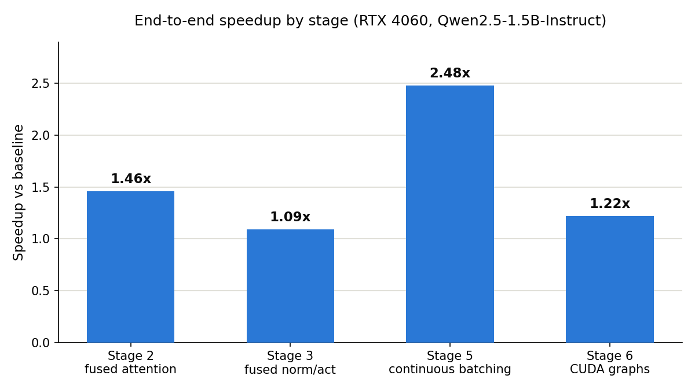
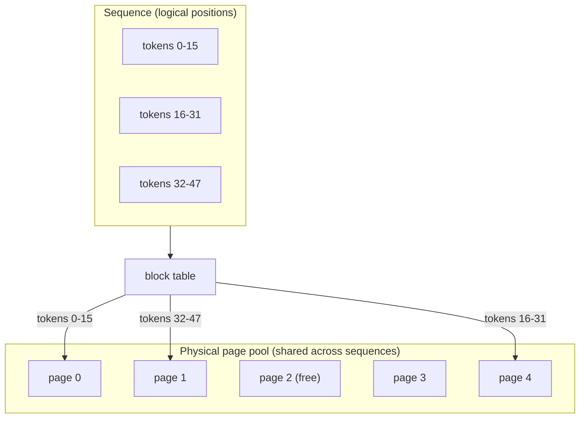

# LLM Inference Optimizer

A from-scratch project exploring GPU-level optimization of large language model (LLM) inference, targeting both **NVIDIA (CUDA)** and **AMD (ROCm/HIP)** platforms.

The project follows the full Software Development Life Cycle (SDLC) — requirements, design, implementation, testing, and deployment — applied to a real systems-engineering problem: making transformer inference faster and cheaper on GPU hardware.

## Why this project

LLM inference has two very different performance regimes:

- **Prefill** (processing the prompt): compute-bound.
- **Decode** (generating tokens one at a time): memory-bandwidth-bound.

Nearly every optimization technique here — kernel fusion, paged KV-cache, continuous batching, quantization, speculative decoding — exists to attack one of those two bottlenecks. This repo documents and implements those techniques incrementally, with every optimization independently measured against a fixed baseline.

## Platforms

| Platform      | Kernel language             | Key libraries                            |
| ------------- | --------------------------- | ----------------------------------------- |
| NVIDIA (CUDA) | CUDA C++ / Triton           | cuBLAS, cuDNN, CUTLASS, NCCL             |
| AMD (ROCm)    | HIP / Triton (ROCm backend) | rocBLAS, MIOpen, Composable Kernel, RCCL |

CUDA development runs locally (RTX 4060). ROCm ports will run on AMD Instinct MI300X via the AMD AI Developer Program's cloud credits, for stages where portability is the point.

## Roadmap (build order)

1. ✅ Baseline inference harness + profiling instrumentation
2. ✅ Fused attention kernel (FlashAttention-style, Triton)
3. ✅ Fused RMSNorm + SwiGLU activation kernels
4. ✅ Paged KV-cache manager + model integration
5. ✅ Continuous batching scheduler
6. ✅ CUDA Graphs for decode
7. ✅ Weight quantization — INT8 done
   - 7b. ✅ INT4 group-wise — done (3.9x memory saving; no speed gain over INT8)
8. ⬜ Speculative decoding
9. ⬜ Multi-GPU parallelism (tensor/pipeline)

Each stage is implemented and benchmarked independently against the Stage 1 baseline before moving to the next.

## Results so far

Hardware: NVIDIA RTX 4060 (8GB), Qwen2.5-1.5B-Instruct, fp16.

**Stage 1 (baseline, eager attention)** — decode scales near-linearly with batch size (memory-bandwidth-bound, as expected): ~47 tok/s at batch 1 → ~384 tok/s at batch 8. Full methodology in [`docs/stage1-baseline.md`](docs/stage1-baseline.md). *(Retroactive note: eager attention was later found to produce NaN logits in this environment — see Stage 3 below. Stage 1's timing numbers remain valid since NaN doesn't change matmul wall-clock time, but the generated text itself was likely garbage throughout, uncaught since this benchmark only ever measured speed.)*

**Stage 2 (Triton fused attention)**:
- Isolated kernel vs. PyTorch SDPA: matches within noise (0.98x–1.00x) at 2048–4096 tokens, ~14x faster than a naive unfused reference at 4096 tokens.
- Wired into the real model via HuggingFace's `AttentionInterface`, with correctness validated by direct logit comparison and greedy-decoding agreement against SDPA on real prompts.
- **End-to-end TTFT: 1.46x faster at 2048-token prompts**, scaling up from 1.04x at 128 tokens.
- Full writeup, including three real integration bugs hit and fixed along the way, in [`docs/stage2-fused-attention.md`](docs/stage2-fused-attention.md) and [`docs/stage2b-integration.md`](docs/stage2b-integration.md).

**Stage 3 (Triton fused RMSNorm + SwiGLU activation)**:
- Isolated kernels vs. naive PyTorch: RMSNorm up to 8.8x faster, SwiGLU up to 1.67x faster at scale (both are small, memory-bound ops — modest wins by design, unlike attention).
- Integrated via **module replacement** rather than forward-method monkey-patching, after empirically proving the latter breaks in this environment independent of kernel correctness.
- **End-to-end: 1.05x–1.09x speedup on both TTFT and decode** (unlike Stage 2, this stage's kernels run during decode too, not just prefill).
- Along the way, root-caused a real, pre-existing bug: `attn_implementation="eager"` produces NaN logits in this torch/transformers/GPU combination, unrelated to anything built here — found via systematic bisection (kernel math → patching mechanism → module replacement → environment itself). Full writeup in [`docs/stage3-fused-norm-activation.md`](docs/stage3-fused-norm-activation.md).

**Stage 4 (paged KV-cache manager + paged attention decode kernel)**:
- A page-based memory manager (`PagedKVCacheManager`) replacing one contiguous per-sequence KV-cache tensor with fixed-size pages allocated on demand — the same idea as OS virtual memory paging, and the core mechanism behind vLLM's PagedAttention.
- A custom Triton decode kernel that gathers K/V from scattered pages via a block table, validated including **variable-length batches** — the actual scenario paging exists for.
- **Memory: 89.1% reduction** vs. naive worst-case pre-allocation on a realistic mixed-length batch — the real payoff of this stage, not raw decode speed (which is roughly on par with a contiguous-cache baseline, as expected for gathered vs. flat memory access).
- Full writeup in [`docs/stage4-paged-kv-cache.md`](docs/stage4-paged-kv-cache.md).

**Stage 4b (wiring the paged cache into real generation)**:
- `PagedEngine`: a manual per-layer forward pass driven by the paged cache, reusing HF's own tested Q/K/V projections and rotary embeddings to minimize the risk of a subtle RoPE bug — the biggest reimplementation in this project at the time.
- Correctness validated against real `model.generate()`, including a genuinely interesting false alarm: the first test run diverged after several correct tokens, which turned out to be caused by `generate()` silently applying a default `repetition_penalty` even in greedy mode — not a bug in `PagedEngine`, which matched a fair manual-loop reference perfectly.
- Found and fixed a real performance bug via benchmarking (not just testing): a Python per-token loop in the cache-write path scaled with sequence length and made TTFT 4–5x slower than baseline; vectorizing it dropped TTFT from 332ms to 68ms at a 512-token prompt (baseline: 62ms).
- Full writeup, including both findings with before/after numbers, in [`docs/stage4b-integration.md`](docs/stage4b-integration.md).

**Stage 5 (continuous batching)**:
- `ContinuousBatchingScheduler` + `ContinuousBatchingEngine`: dynamic admission (a new request joins the moment a slot frees up, rather than waiting for a whole static batch to finish), batching multiple sequences' decode steps — each potentially at a different context length — into a single kernel call per iteration. Needed almost no new kernel work, since Stage 4's paged attention kernel already supported variable-length batches.
- Correctness validated against standalone per-sequence execution, including **staggered arrival** (a request added mid-stream, after others are already several decode steps in) — the actual scenario this stage exists for.
- **Throughput: 2.48x speedup** (24.6 → 61.0 tok/s aggregate) processing 16 varying-length requests, versus running them one at a time.
- Chunked prefill (mixing prefill into the same batched call as decode) explicitly scoped out as further real-systems work. Full writeup in [`docs/stage5-continuous-batching.md`](docs/stage5-continuous-batching.md).

**Stage 6 (CUDA graphs for decode)**:
- `GraphedDecodeEngine`: captures decode's entire per-step kernel-launch sequence once, using pre-allocated static buffers (overwritten in place every call, never reallocated) so the same captured graph correctly replays for any sequence at any context length — reusing Stage 4's masking-by-real-context-length design, which turns out to be exactly what graph capture needs too.
- Hit a genuinely subtle bug: the first captured token consistently came out wrong. Three plausible causes (the static-buffer refactor itself, a side-stream warmup pattern, Triton/CUDA-graph incompatibility) were each tested and eliminated in turn before finding the real cause — CUDA graph capture's own execution pass doesn't guarantee a valid result; only a subsequent `replay()` does. Fixed by replaying once immediately after capture.
- **Result: 1.22x steady-state decode speedup** (42.1 → 51.4 tok/s), with only 47ms one-time capture cost.
- Deliberately not combined with Stage 5's dynamic batch sizes (a harder graph-capture problem — real systems bucket to a few fixed batch sizes). Full writeup, including the elimination trail, in [`docs/stage6-cuda-graphs.md`](docs/stage6-cuda-graphs.md).

**Stage 7 (INT8 weight quantization)**:
- Weight-only, per-output-channel symmetric INT8 (W8A16): weights stored as int8 with one scale per output row, activations stay fp16. A custom Triton kernel accumulates `x @ Wq^T` in fp32 and applies the scale once at the end instead of dequantizing every weight tile. Integrated via module replacement (196 linear layers), so it composes with `PagedEngine`, `ContinuousBatchingEngine` and `GraphedDecodeEngine` unchanged. Embeddings and `lm_head` stay fp16 (tied weights).
- The Stage 7 tests pass (reported as 55). Because fp16 and int8 aren't numerically identical, end-to-end accuracy is checked by logit cosine similarity and top-1 agreement rate rather than exact token equality.
- **Memory: transformer-layer weights 2499 MB → 1252 MB (2.00x smaller); peak 2995 → 1748 MB.**
- **Speed is mixed, and the mix is the finding:** with CUDA graphs (launch overhead removed), batch-1 decode goes **68.4 → 104.3 tok/s (1.52x)**, reproduced in a second run (69.5 → 104.2, 1.50x). In isolation the kernel beats cuBLAS fp16 by up to 2.4x on the large MLP matrices at decode-shaped M, but loses on small projections (0.6x–0.8x) and at prefill-sized M (~0.9x). On the plain HF path INT8 is slightly *slower* than fp16 (0.93x at batch 1, 0.87x at batch 8 on re-measurement); the first run's apparent 0.61x collapse and doubled TTFT did not reproduce and are treated as noise, as is its 1.21x batch-8 figure.
- The kernel is deliberately untuned (fixed block sizes, no autotune, which is incompatible with CUDA graph capture); per-shape tuning is the obvious next step. INT4 followed as Stage 7b. Full tables and caveats in [`docs/stage7-quantization.md`](docs/stage7-quantization.md).

**Stage 7b (INT4 group-wise weight quantization)**:
- All 55 kernel/quantizer tests and the 3 end-to-end tests pass. Group-wise symmetric INT4 (group size 128, fp16 scales), two weights packed per byte in a layout that keeps activation loads contiguous. Plain round-to-nearest (no GPTQ/AWQ). Same module-replacement integration as Stage 7.
- **Memory: transformer-layer weights 2499 MB → 645 MB (3.88x smaller); peak 2995 → 1179 MB at batch 1.**
- **Accuracy cost is real:** logit cosine vs fp16 0.9378 and 80% top-1 agreement on a 60-token prompt (INT8: 0.9991 / 96.7%). My first accuracy threshold (cosine > 0.95) was a guess and failed; the bar was reset from this measurement, and the docs say so.
- **No speedup over INT8:** graphed decode 102.0 vs INT8's 104.2 tok/s (fp16: 69.5), despite reading half the bytes. The INT4 kernel reaches only ~116 GB/s at best (INT8's reached ~235–255), so it isn't bandwidth-bound; it also loses to INT8 on the down projection (1.02x vs 2.03x at M=1) and is ~0.5x fp16 at prefill-sized M (batch-8 TTFT 196 vs 120 ms).
- Takeaway: INT8 is the better speed/accuracy trade here; INT4 is for when memory is the constraint. Tuning the kernel and calibrated quantization are the obvious next steps, not done. Details in [`docs/stage7b-int4.md`](docs/stage7b-int4.md).

## Visual summary



Stage 4 isn't shown above — its headline result was memory efficiency (89.1% reduction), not speed, which doesn't belong on the same axis as the others. The mechanism behind Stages 4-6, in one picture: a sequence's logical token positions map through a block table to physical pages scattered across a shared pool, allocated only as needed, rather than one contiguous buffer reserved per sequence.



## Repository structure

```
.
├── docs/
│   ├── architecture-cuda.md              # Full SDLC architecture doc (CUDA target)
│   ├── architecture-rocm.md              # Full SDLC architecture doc (ROCm/HIP target)
│   ├── stage1-baseline.md                # Stage 1 methodology
│   ├── stage2-fused-attention.md         # Stage 2 kernel methodology
│   ├── stage2b-integration.md            # Stage 2 end-to-end integration notes
│   ├── stage3-fused-norm-activation.md   # Stage 3 methodology + eager-attention bug writeup
│   ├── stage4-paged-kv-cache.md          # Stage 4 manager + kernel methodology
│   ├── stage4b-integration.md            # Stage 4b model integration + perf/test bug writeups
│   ├── stage5-continuous-batching.md     # Stage 5 scheduler methodology
│   ├── stage6-cuda-graphs.md             # Stage 6 graph capture methodology + debugging trail
│   ├── stage7-quantization.md            # Stage 7 INT8 weight quantization methodology
│   └── stage7b-int4.md                   # Stage 7b INT4 group-wise quantization
├── src/
│   ├── kernels/                          # Custom Triton/CUDA kernels (incl. W8A16 / W4A16 matmul)
│   ├── kv_cache/                         # Paged KV-cache allocator + manager
│   ├── quantization/                     # INT8 / INT4 weight quantization (model-wide module replacement)
│   └── engine/                           # Model loading, inference loops, scheduler, attention/norm/MLP dispatch, profiling
├── benchmarks/                           # Microbenchmarks + end-to-end throughput/latency/memory tests
├── tests/                                # Correctness + regression tests
├── requirements.txt
└── README.md
```

## Getting started

Requires a CUDA-capable NVIDIA GPU (developed against an RTX 4060, 8GB) or an AMD GPU via ROCm (later stages).

```bash
pip install -r requirements.txt

# CUDA-enabled torch (pip's default torch wheel is CPU-only on Windows):
pip install torch --index-url https://download.pytorch.org/whl/cu126  # match your driver's CUDA version

# Triton (Stage 2+):
# Linux/WSL2:      pip install triton
# Windows (native): pip install -U "triton-windows<3.7"  — also requires MSVC Build Tools
#                    ("Desktop development with C++" workload)
```

Run the Stage 1 baseline:
```bash
python benchmarks/run_baseline.py
```

Run Stage 2 (kernel correctness + isolated benchmark + end-to-end benchmark):
```bash
pytest tests/test_flash_attention_kernel.py -v
python benchmarks/run_stage2_attention.py

pytest tests/test_e2e_attention_patch.py -v
python benchmarks/run_stage2_e2e.py
```

Run Stage 3 (kernel correctness + isolated benchmark + end-to-end benchmark):
```bash
pytest tests/test_fused_norm_activation_kernels.py -v
python benchmarks/run_stage3_kernels.py

pytest tests/test_e2e_stage3.py -v
python benchmarks/run_stage3_e2e.py
```

Run Stage 4/4b (kernel + manager correctness, isolated speed + memory benchmarks, end-to-end integration correctness + benchmark):
```bash
pytest tests/test_paged_attention_kernel.py -v
python benchmarks/run_stage4_kernel.py
python benchmarks/run_stage4_memory.py

pytest tests/test_e2e_paged_engine.py -v
python benchmarks/run_stage4b_e2e.py
```

Run Stage 5 (correctness, including staggered arrival + throughput benchmark):
```bash
pytest tests/test_continuous_batching.py -v
python benchmarks/run_stage5_e2e.py
```

Run Stage 6 (graph correctness + decode throughput benchmark):
```bash
pytest tests/test_graphed_decode.py -v
python benchmarks/run_stage6_e2e.py
```

Run Stage 7 (INT8 kernel + quantization correctness first, then the kernel-vs-cuBLAS benchmark, then the end-to-end benchmark):
```bash
pytest tests/test_w8a16_kernel.py -v
pytest tests/test_e2e_quantization.py -v
python benchmarks/run_stage7_kernel.py
python benchmarks/run_stage7_e2e.py
```

Run Stage 7b (INT4 kernel + quantization correctness first, then kernel benchmark, then the fp16/INT8/INT4 end-to-end benchmark):
```bash
pytest tests/test_w4a16_kernel.py -v
pytest tests/test_e2e_int4.py -v -s
python benchmarks/run_stage7b_kernel.py
python benchmarks/run_stage7b_e2e.py
```

**Note:** correctness tests use `attn_implementation="sdpa"` as the reference, not `"eager"` — see Stage 3's writeup for why.

## References

- FlashAttention (Dao et al.)
- vLLM / PagedAttention (Kwon et al.)
- NVIDIA CUTLASS / TensorRT-LLM
- AMD Composable Kernel / ROCm documentation
- Triton (OpenAI) / [triton-windows](https://github.com/triton-lang/triton-windows)

## License

TBD
